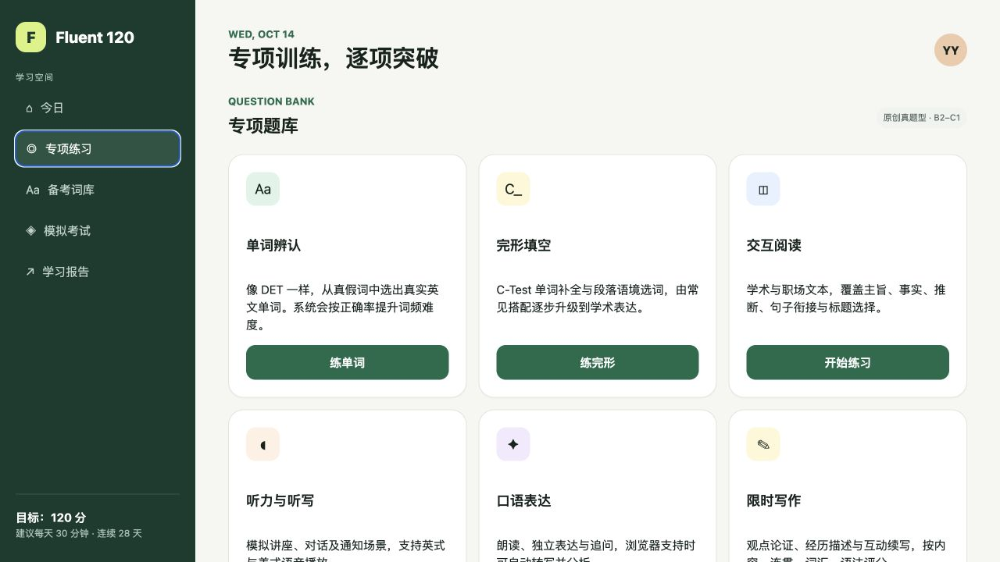
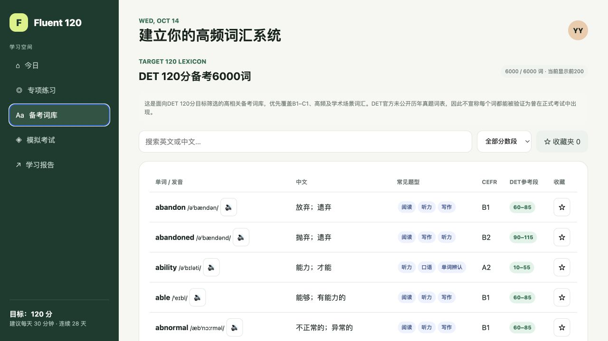

# Fluent 120

一个无需安装、打开浏览器即可练习的英语冲刺网页应用。覆盖阅读、听力、口语、写作、词汇与 120 分制模拟考试，适合用于日常训练和阶段性自测。

<p align="center">
  <a href="https://yiyiyi1995.github.io/english-practice-app/"><strong>在线体验 Fluent 120 →</strong></a>
</p>

> 应用优先加载仓库内的完整 A1–C2 词库；本地文件不可用时尝试 CDN，二者均失败时自动使用内置核心词库。

## 界面预览

### 专项练习



### 备考词库



## 功能列表

- **28 天冲刺计划**：按日安排练习量，记录连续学习状态。
- **专项训练**：包含单词辨认、完形填空、交互阅读、听力听写、口语表达和限时写作。
- **6000 词备考词库**：从 9,441 条本地 A1–C2 数据中按备考优先级筛选，支持中英文搜索、分数段筛选、发音播放和本地收藏。
- **模拟考试**：按阅读、听力、口语、写作四项生成 120 分制训练估分。
- **学习报告**：查看各项能力表现和最近一次练习结果。
- **本地数据保存**：收藏、打卡和最近成绩保存在浏览器 `localStorage` 中。
- **本地优先与离线回退**：优先读取仓库内的完整词库，本地和 CDN 均不可用时切换到内置核心词库。

## 使用方法

### 在线使用

打开 [Fluent 120 在线版](https://yiyiyi1995.github.io/english-practice-app/) 即可开始练习。

### 本地使用

克隆仓库：

```bash
git clone https://github.com/yiyiyi1995/english-practice-app.git
cd english-practice-app
```

直接双击 `index.html`，或启动一个本地服务器：

```bash
python3 -m http.server 8080
```

然后访问 <http://localhost:8080>。

## 设备与浏览器支持

| 环境 | 支持情况 | 说明 |
| --- | --- | --- |
| Chrome / Edge 桌面版 | 推荐 | 支持完整界面、语音合成和浏览器允许时的语音识别 |
| Safari / Firefox 桌面版 | 基本支持 | 主要练习可用，语音识别能力可能受限 |
| 手机浏览器 | 响应式支持 | 导航和卡片会适配小屏；建议使用最新版 Chrome 或 Safari |
| 离线使用 | 支持 | 通过本地服务器运行时可使用完整本地词库；直接双击 `index.html` 时可能因浏览器安全限制退回核心词库 |

> 听力播放使用浏览器内置语音合成。口语自动转写依赖浏览器的 Web Speech API；不支持时可以手动输入答案。

## 项目路线图

- [x] 每日训练与连续学习记录
- [x] 六类专项练习
- [x] 120 分制模拟考试与能力拆分
- [x] 6000 词在线词库、搜索和收藏
- [x] 桌面端与移动端响应式布局
- [x] 将完整 A1–C2 词库纳入仓库，增强离线能力
- [ ] 增加错题本和历史成绩趋势
- [ ] 增加更多原创练习题和难度分层
- [ ] 增加可安装的 PWA 模式
- [ ] 补充自动化测试和无障碍优化

## 参与项目

欢迎通过以下方式参与：

- ⭐ 给仓库点一个 **Star**，让更多学习者发现它。
- 🐛 通过 **Issue** 报告问题或提出功能建议。
- 🔀 通过 **Pull Request** 提交修复、新题目或体验改进。

## 说明

- 题目为原创内容，题型参考数字化英语能力测试，难度约 B2–C1。
- 模考总分 120，四项各 30 分。
- 写作、口语采用本地启发式规则估分，仅用于训练反馈，不是官方成绩。
- 本项目与 Duolingo 或 Duolingo English Test 官方无隶属、授权或背书关系。

## 开源许可证

本项目代码采用 [MIT License](LICENSE)。`data/` 下的第三方词库数据另见 [THIRD_PARTY_NOTICES.md](THIRD_PARTY_NOTICES.md)，使用和再分发时需遵守其数据许可证。
